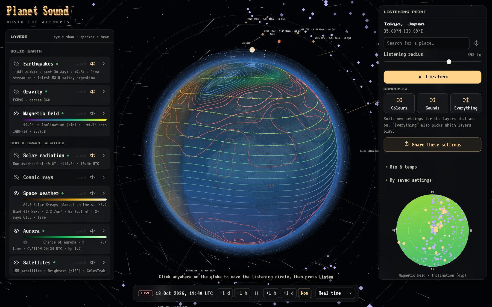

  

  <b>A 3D globe of live Earth and space data that you can see and hear.</b> 
  Pick a spot and a radius. A radar beam sweeps the circle, and every layer plays what it finds.

  

  
   Magnetic dip and air pressure as contour lines, with the solar wind, satellites, asteroid flybys and the planets switched on.

---

## Layers

Every layer is real data: live feeds where they exist, and published scientific models where they don't.

| Group | Layers |
| --- | --- |
| **Solid Earth** | Earthquakes (USGS, plus EMSC's live stream) · Gravity (EGM96 to degree 360) · Magnetic field (IGRF-14, any year from 1900 to 2030) |
| **Sun & space weather** | Solar radiation · Cosmic rays (cutoff rigidity and live neutron monitors) · Space weather (solar wind, X-ray flares) · Aurora (NOAA OVATION) · Satellites (CelesTrak orbits, SGP4) |
| **Sky & beyond** | Sky & tides (Moon, planets, tidal pull) · Asteroid flybys (NASA JPL) · Meteor fireballs (NASA JPL) · Gravitational waves (LIGO–Virgo–KAGRA alerts) |
| **Atmosphere & oceans** | Temperature · Wind · Cloud · Pressure · Humidity · Air quality · Ocean (Open-Meteo) |

## Look

Each layer has its own colour ramp and opacity, and can be drawn smooth, in bands or as **contour lines**,
flat or raised into **3D relief**. Overlay several at once and the globe becomes a map of how they line up.

## Sound

Each layer is its own instrument, picked from 31 voices: FM electric piano, a Moog-style mono synth,
supersaw, vowel choir, theremin, plucked string, granular cloud, 808 kit and more. They play in a shared
key through a choice of modes:

- **Drone** follows the average inside the circle.
- **Sweep** plays a melody from the values along the beam as it turns.
- **Arpeggio** builds chords from the beam and breaks them up.
- **Pulse** clicks like a Geiger counter.
- **Radar** pings each earthquake as the beam passes it.
- **Timeline** replays the quakes in the order they happened.

East is heard on the right and west on the left. Time can run live, be scrubbed back and forth, or sped up
to a week a second.

Settings can be saved as presets, rolled at random with the dice, or sent as a short share link.

## Under the hood

Three.js and the Web Audio API, written as plain ES modules with no build step. One shader draws every
field layer, and IGRF and orbit propagation are computed in the browser. Hosted on Cloudflare Pages, with
small Cloudflare Functions relaying the feeds that block browsers.

## Data & credits

USGS Earthquake Hazards Program · EMSC · EGM96 (NASA GSFC / NIMA) via ICGEM · IGRF-14 (IAGA) ·
NOAA SWPC · NMDB · CelesTrak · satellite.js · NASA JPL CNEOS · GraceDB · Open-Meteo (CC BY 4.0) ·
astronomy-engine · NASA Blue Marble / Black Marble via three-globe · Three.js

---

This repository is a showcase: the source code is private. © Matthew Lenkiewicz. Images and text
all rights reserved.
